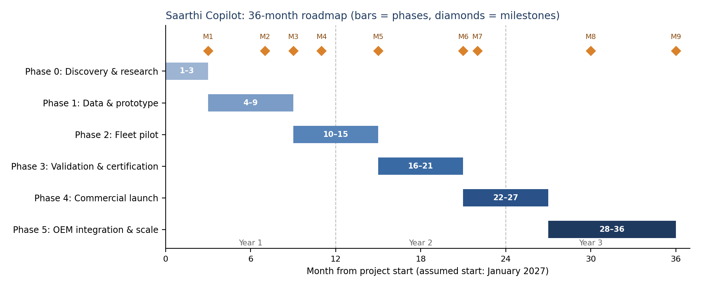

# Strategic Roadmap for Automotive AI Innovation

**Week 1 task, Automotive AI Innovation Internship (YuvaIntern)**

This repository holds a three-year strategic roadmap for **Saarthi Copilot**, a hypothetical edge-AI driver safety and vehicle health co-pilot designed for Indian roads.

📄 **Full report:** [Week1_Strategic_Roadmap_Automotive_AI.docx](Week1_Strategic_Roadmap_Automotive_AI.docx)

## The concept

India recorded 4,61,312 road accidents and 1,68,491 deaths in 2022 (MoRTH). Most were caused by human factors such as fatigue, distraction and over-speeding. Factory-fitted ADAS can help, but it is mostly limited to top variants of new cars and is tuned for orderly, well-marked roads.

Saarthi Copilot is a windshield unit with two cameras, an edge AI processor and an OBD-II link. It has five modules:

| Module | What it does |
|---|---|
| Driver Monitoring System | Infrared camera detects drowsiness, distraction and phone use |
| Forward Perception | Collision and lane departure warnings tuned for two-wheelers, auto-rickshaws, pedestrians and animals |
| Vehicle Health Intelligence | Predicts maintenance needs from OBD-II/CAN data |
| Multilingual Voice Interface | Short alerts in Hindi, English and regional languages |
| Fleet and Insurer Cloud | Event-only uploads for driver scorecards, coaching and usage-based insurance |

All video is processed on the device: the system works without mobile signal, and no continuous video ever leaves the vehicle.

## Roadmap



| Phase | Months | Main deliverable |
|---|---|---|
| 0. Discovery and research | 1–3 | Requirements and hardware platform |
| 1. Data and prototype | 4–9 | 1,000+ hours of labelled Indian driving data; working prototype |
| 2. Fleet pilot | 10–15 | 200-vehicle pilot in Indore, Bhopal and Pune |
| 3. Validation and certification | 16–21 | ISO 26262 / SOTIF safety case; ARAI/ICAT testing |
| 4. Commercial launch | 22–27 | Fleet subscription and aftermarket kit; 5,000 units |
| 5. OEM integration and scale | 28–36 | Tier-1/OEM licensing deal; 25,000 active units |

## Resources at a glance

- **Team:** 12 people in Phases 0–1, growing to 22, then 30
- **Budget:** about ₹19.76 crore over three years, including 15% contingency
- **Target unit cost:** ₹7,500 bill of materials, ₹14,999 retail kit, ₹249 per vehicle per month for fleets

## What the report covers

1. Executive summary
2. Introduction to the AI solution concept
3. Market analysis (road-safety data, Indian market, regulation, competitors, SWOT, business model)
4. Technology trends (edge AI chips, model compression, driver monitoring, OTA updates, in-car AI assistants, Indian datasets, federated learning)
5. Pain points in current automotive solutions
6. High-level system architecture
7. Roadmap: phases, milestones and Gantt chart
8. Resource estimates: team, budget, infrastructure, unit economics
9. Challenges and risk register
10. Success metrics (KPIs)
11. Conclusion and references

## Repository contents

```
.
├── README.md
├── Week1_Strategic_Roadmap_Automotive_AI.docx   # the full report
└── images/
    └── roadmap_gantt.png                        # roadmap chart used in the report
```
