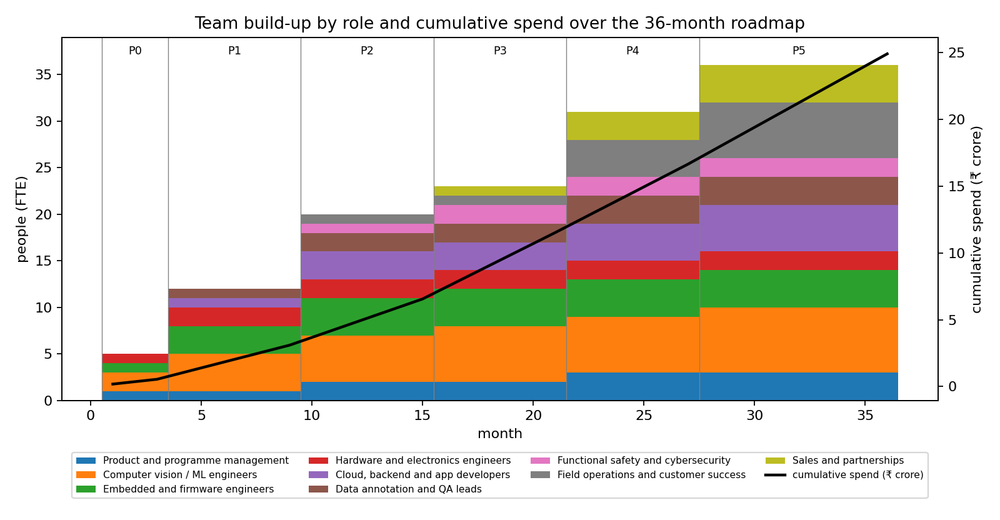
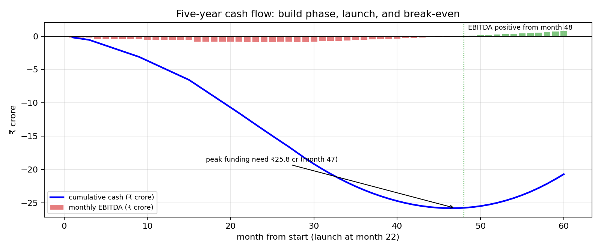
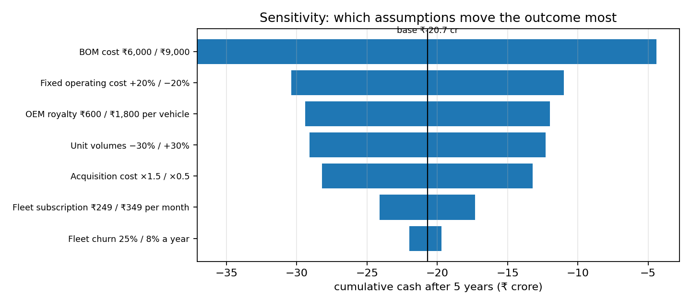
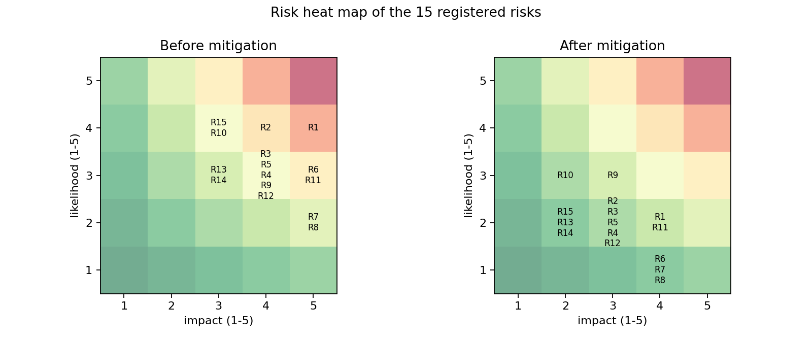

# Strategic Roadmap for Automotive AI Innovation

**Week 1 task, Automotive AI Innovation Internship (YuvaIntern)**

This repository holds a three-year strategic roadmap for **Saarthi Copilot**, a hypothetical edge-AI driver safety and vehicle health co-pilot designed for Indian roads.

📄 **Full report:** [Week1_Strategic_Roadmap_Automotive_AI.docx](Week1_Strategic_Roadmap_Automotive_AI.docx)

## The concept

India recorded 4,61,312 road accidents and 1,68,491 deaths in 2022 (MoRTH). Most were caused by human factors such as fatigue, distraction and over-speeding. Factory-fitted ADAS can help, but it is mostly limited to top variants of new cars and is tuned for orderly, well-marked roads.

Saarthi Copilot is a windshield unit with two cameras, an edge AI processor and an OBD-II link. It has five modules:

| Module | What it does |
|---|---|
| Driver Monitoring System | Infrared camera detects drowsiness, distraction and phone use |
| Forward Perception | Collision and lane departure warnings tuned for two-wheelers, auto-rickshaws, pedestrians and animals |
| Vehicle Health Intelligence | Predicts maintenance needs from OBD-II/CAN data |
| Multilingual Voice Interface | Short alerts in Hindi, English and regional languages |
| Fleet and Insurer Cloud | Event-only uploads for driver scorecards, coaching and usage-based insurance |

All video is processed on the device: the system works without mobile signal, and no continuous video ever leaves the vehicle.

## Roadmap


| Phase | Months | Main deliverable |
|---|---|---|
| 0. Discovery and research | 1–3 | Requirements and hardware platform |
| 1. Data and prototype | 4–9 | 1,000+ hours of labelled Indian driving data; working prototype |
| 2. Fleet pilot | 10–15 | 200-vehicle pilot in Indore, Bhopal and Pune |
| 3. Validation and certification | 16–21 | ISO 26262 / SOTIF safety case; ARAI/ICAT testing |
| 4. Commercial launch | 22–27 | Fleet subscription and aftermarket kit; about 5,000 units |
| 5. OEM integration and scale | 28–36 | Tier-1/OEM licensing deal; about 18,000 active units plus factory fitment |

## Bottom-up model (src/roadmap_model.py)

| | |
|---|---|
| Team | 5 → 12 → 20 → 23 → 31 → 36 people across nine roles; **855 person-months** |
| 36-month build budget | **₹24.9 crore** incl. 15% contingency, costed by role and purchase for each phase |
| Fleet unit economics | ₹11,999 kit + ₹299/month → ₹914 hardware contribution, ₹183/month per vehicle, **LTV/CAC 9.7×**, CAC recovered in ~3 months |
| First-draft pricing check | old ₹9,999 fleet kit lost **₹930 per unit** once GST, installation and warranty were counted; fixed in the revised plan |
| Break-even | EBITDA positive from **month 48** at ~46,000 active units |
| Funding need | peak **₹25.8 crore** (month 47); year-5 revenue ₹79.8 crore, EBITDA ₹5.1 crore |
| Biggest lever | bill of materials: every ₹1,000 saved per unit ≈ ₹11 crore over five years |
| Risk register | 15 risks with likelihood, impact, owner, mitigation, contingency, residual score and phase |






## What the report covers

1. Executive summary
2. Introduction to the AI solution concept
3. Market analysis (road-safety data, Indian market, regulation, competitors, SWOT, business model)
4. Technology trends
5. Pain points in current automotive solutions
6. High-level system architecture
7. Roadmap: phases, milestones and Gantt chart
8. Resource estimates by phase: team by role, budget by phase, what each phase buys, funding plan
9. Unit economics: first-draft check, revised pricing, worked example, LTV/CAC
10. Five-year financial projection and sensitivity analysis
11. Risk register and heat map
12. Success metrics, 13. Conclusion, references, model assumptions

## Repository contents

```
src/roadmap_model.py     resource, unit-economics, projection, sensitivity and risk model
src/build_report.py      builds the Word report from the model outputs
src/doclib.py            small python-docx helper
content/base_text.json   reusable text sections of the report
results/                 phase_budget.csv, unit_economics.csv, annual_pnl.csv, sensitivity.csv, risk_register.csv, model.json
figures/ images/         charts used in the report
```

## Reproduce

```bash
pip install numpy pandas matplotlib python-docx
python src/roadmap_model.py
python src/build_report.py
```

All inputs are labelled assumptions at the top of `src/roadmap_model.py`; change one and re-run to see its effect.

---
Him Sharma · Automotive AI Innovation Internship (YuvaIntern) · November 2026
